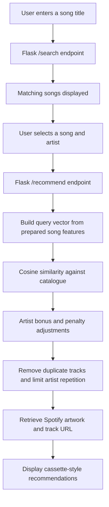

# AChord 🎵

**AChord** is a content-based music recommendation web application. Select a song and AChord finds tracks with similar audio characteristics and genre profiles, then presents the recommendations as cassette-style cards that link to Spotify.

The project combines a Spotify track dataset, genre enrichment using the Last.fm API, genre-cleaning and feature-engineering notebooks, and a Flask application with a custom HTML/CSS/JavaScript interface.

## Table of contents

- [Features](#features)
- [How it works](#how-it-works)
- [Recommendation algorithm](#recommendation-algorithm)
- [Model experiments](#model-experiments)
- [Data pipeline](#data-pipeline)
- [Project structure](#project-structure)
- [Run the web application](#run-the-web-application)
- [API endpoints](#api-endpoints)
- [Research notebooks](#research-notebooks)
- [Dataset notes](#dataset-notes)
- [Credentials and security](#credentials-and-security)
- [Current limitations](#current-limitations)

## Features

- Search the local song catalogue by track title.
- Display up to 10 matching tracks while typing.
- Use the selected artist to disambiguate songs with the same title.
- Generate up to five recommendations using audio features, genre information, and artist relationships.
- Reduce repeated recommendations by removing duplicate title/artist pairs and limiting the number of recommendations from a primary artist.
- Enrich recommendations with Spotify album artwork and Spotify track links.
- Present results in a custom cassette-inspired interface with an animated vinyl record, custom fonts, and a warm orange-and-black colour scheme.

## How it works



The recommendation calculation is performed locally using the processed CSV dataset. The Spotify Web API is used by the application to retrieve a track's album image and Spotify URL for display; it is not the source of the recommendation scores.

## Recommendation algorithm

The final `app.py` uses **content-based filtering with cosine similarity**.

### 1. Song representation

Each track is represented using the following Spotify-derived features:

| Feature group | Features |
|---|---|
| Audio and popularity | `danceability`, `energy`, `loudness`, `speechiness`, `acousticness`, `instrumentalness`, `liveness`, `valence`, `tempo`, `popularity` |
| Genres | Multi-hot encoded columns generated from `genres_filtered` |

Genre strings are split into individual labels and encoded with scikit-learn's `MultiLabelBinarizer`. The resulting genre columns are multiplied by `0.5` before being combined with the base features. Missing feature values are filled with zero, and `StandardScaler` is fitted to the complete feature matrix.

### 2. Similarity score

For a selected song, the application computes cosine similarity between its scaled feature vector and every row in the catalogue. It then adjusts the similarity scores using artist relationships:

```text
final_score = cosine_similarity
              + shared_artist_bonus
              - same_primary_artist_penalty
```

The current weights in `app.py` are:

| Adjustment | Weight | Behaviour |
|---|---:|---|
| Collaboration bonus | `+0.15` | Applied when a candidate shares at least one artist with the selected track. |
| Input-primary-artist penalty | `-0.10` | Applied when the selected track's primary artist appears anywhere in the candidate track's artist list. |

The selected track itself is excluded from the results. The `-0.10` rule checks whether the input track's primary artist appears anywhere in the candidate's artist list; it is not limited to the candidate's first-listed artist.

### 3. Result selection

The application sorts candidates by their adjusted scores, then applies these rules:

- Normalize track names by lowercasing and removing punctuation.
- Remove duplicate `(normalized track name, primary artist)` pairs.
- Return no more than two tracks for any one primary artist.
- Skip candidates that do not have a primary artist.
- Stop after collecting the requested number of recommendations (five by default).

The result count can be lower than five if too few candidates remain after filtering.

## Model experiments

The notebooks contain three recommendation approaches built around the prepared audio and genre feature matrix:

| Approach | Method | Role in the project |
|---|---|---|
| Cosine Similarity | Ranks the full catalogue by cosine similarity, with artist-based score adjustments. | Selected for the final Flask application. |
| K-Nearest Neighbors (KNN) | Uses scikit-learn `NearestNeighbors` with Euclidean distance and brute-force search, followed by duplicate and artist-diversity filtering. | Experimental alternative. |
| KMeans | Assigns tracks to 50 clusters and selects candidates from the selected track's cluster. | Experimental alternative. |

The comparison notebooks inspect recommendations using:

- Line plots comparing scaled audio features.
- Heatmaps of the selected track and recommended tracks.
- Radar plots for selected audio features.
- Genre overlap measured with Jaccard similarity: `|A ∩ B| / |A ∪ B|`.

The notebooks include observations about trade-offs: KNN can return fewer than the requested number after filtering its candidate list, while the KMeans experiments include examples with audio-feature overlap but weak genre overlap. These experiments are exploratory comparisons, not a reported held-out benchmark.

## Data pipeline

The data-preparation work is documented in the Jupyter notebooks. The pipeline represented by those notebooks is:

1. **Load and filter the source catalogue.** The filtering notebook keeps tracks with `year >= 1999` and `popularity >= 50`. The uploaded source snapshot contains 170,653 rows; this filter produces 27,803 rows.
2. **Extract the primary artist.** The `artists` field is parsed from its list-like representation and the first artist is saved as `main_artist`.
3. **Fetch genre tags from Last.fm.** The genre-fetching notebook requests track tags using the track title and artist. When no usable track tags are returned, it falls back to the artist's top tags. The scripts include retry handling and periodic checkpoint files so processing can resume.
4. **Normalize and clean genre labels.** Variants such as different spellings, spacing, and hyphenation are mapped to canonical labels. Numeric tags, overly long labels, duplicates, and tags that resemble the artist name are filtered.
5. **Remove manually identified noise tags.** A curated `tags.csv` list is used by the cleaning notebook to remove additional unwanted labels.
6. **Merge genres into the song catalogue.** The merge notebook normalizes title and primary-artist text, then performs a left join so the original catalogue is retained. The final application dataset contains the `genres_filtered` column used by the recommender.
7. **Build and compare recommendation models.** The model notebooks prepare audio and genre features, scale them, run the three recommendation approaches, and compare their outputs.

The notebooks also contain a separate `leftovers.ipynb` pass for a small set of tracks processed after the main genre-tagging run.

## Project structure

The web application expects the following structure (the notebook and dataset filenames shown here may be arranged into folders as you prefer):

```text
AChord/
├── app.py
├── songs_with_genres_final.csv
├── templates/
│   └── index.html
├── static/
│   ├── fonts/
│   │   ├── Archive Regular.ttf
│   │   └── VanDoesburgArchiType Regular.ttf
│   └── images/
│       ├── AChord Logo.png
│       ├── AChord Logo Short.png
│       ├── vinyl.png
│       └── cassettes.png
└── notebooks/
    ├── data_filtering.ipynb
    ├── api_genres.ipynb
    ├── genre_cleaning(1).ipynb
    ├── leftovers.ipynb
    ├── merge.ipynb
    ├── rec_engine(cosine_similarity)(2).ipynb
    ├── rec_engine(KNN)(2).ipynb
    ├── rec_engine(KMeans)(2).ipynb
    └── GraphsAndComparison.ipynb
```

**Important:** `app.py` loads `songs_with_genres_final.csv` from the application's current working directory. The uploaded final dataset file was named `songs_with_genres_final(1).csv`; rename or copy it to `songs_with_genres_final.csv` when setting up the application. The `templates` and `static` paths must match the paths referenced by `index.html`.

## Run the web application

### Requirements

- Python 3
- Flask
- pandas
- scikit-learn
- Spotipy
- Spotify Developer credentials
- The processed CSV file and frontend static assets

The project files do not include a pinned `requirements.txt`, so install the runtime dependencies directly:

```bash
pip install Flask pandas scikit-learn spotipy
```

For working with the research notebooks, you will also need Jupyter, NumPy, Matplotlib, Seaborn, and Requests:

```bash
pip install jupyter numpy matplotlib seaborn requests
```

### 1. Set up the files

Place `app.py`, `songs_with_genres_final.csv`, the `templates/` directory, and the `static/` directory together in the project root as shown above.

### 2. Configure Spotify credentials

The Spotify client in `app.py` uses Spotipy's `SpotifyClientCredentials` flow. Replace the `YOUR_ID` and `YOUR_SECRET` placeholders in the current code with credentials from a Spotify Developer application:

```python
sp = spotipy.Spotify(auth_manager=SpotifyClientCredentials(
    client_id="YOUR_ID",
    client_secret="YOUR_SECRET"
))
```

Keep real credentials private. Do not commit them to source control.

### 3. Start Flask

From the project root, run:

```bash
python app.py
```

Open the local development URL printed by Flask (normally `http://127.0.0.1:5000/`). Enter at least two characters of a song title, select the matching song from the suggestions, and view the recommendations.

> The current application runs with `debug=True`, which is intended for local development. Disable debug mode before deploying the application publicly.

## API endpoints

### `GET /`

Renders the main interface from `templates/index.html`.

### `GET /search?q=<song-title>`

Searches the local dataset for track names containing the query (case-insensitive). Queries shorter than two characters return an empty result list. At most ten matches are returned.

Example response shape:

```json
{
  "results": [
    {
      "name": "Example Track",
      "artists": ["Example Artist"]
    }
  ]
}
```

### `POST /recommend`

Accepts a JSON object containing the selected song and artist, then returns the recommended tracks enriched with Spotify image and URL fields.

Request:

```json
{
  "song": "Example Track",
  "artist": "Example Artist"
}
```

Each recommendation includes the dataset fields `id`, `name`, `artists`, `genres_filtered`, and `popularity`, along with:

| Field | Description |
|---|---|
| `image` | Spotify album image URL, or a placeholder image if unavailable. |
| `url` | Spotify track URL, or `#` if the lookup fails. |

## Research notebooks

| Notebook | Purpose |
|---|---|
| `data_filtering.ipynb` | Filters the source catalogue by year and popularity and extracts the primary artist. |
| `api_genres.ipynb` | Retrieves Last.fm track tags, uses artist tags as a fallback, normalizes tags, and saves checkpoints. |
| `leftovers.ipynb` | Runs a follow-up genre-tagging pass for remaining tracks. |
| `genre_cleaning(1).ipynb` | Canonicalizes genre labels, removes artist-name tags and manually curated noise tags, and analyzes genre frequency. |
| `merge.ipynb` | Joins cleaned genre data to the original song catalogue using normalized track and artist names. |
| `rec_engine(cosine_similarity)(2).ipynb` | Develops the cosine-similarity recommender and genre/audio-feature comparisons. |
| `rec_engine(KNN)(2).ipynb` | Explores a nearest-neighbor recommender. |
| `rec_engine(KMeans)(2).ipynb` | Explores cluster-based recommendations. |
| `GraphsAndComparison.ipynb` | Compares the three approaches using feature plots, heatmaps, radar charts, and genre Jaccard scores. |

## Dataset notes

The supplied files represent different stages of preparation:

| Dataset file | Observed size | Purpose |
|---|---:|---|
| `songs(20261119-134055).csv` | 170,653 rows × 21 columns | Uploaded source catalogue snapshot. |
| `filtered_songs.csv` | 27,803 rows × 21 columns | Tracks meeting the year and popularity filters. |
| `songs_main_artist(1).csv` | 27,803 rows × 2 columns | Track title and extracted primary artist. |
| `songs_cleaned_final.csv` | 27,803 rows × 5 columns | Genre tags after canonicalization and artist-tag removal. |
| `songs_with_cleaned_genres_v2.csv` | 27,803 rows × 4 columns | Intermediate cleaned-genre data. |
| `songs_with_genres_final(1).csv` | 173,613 rows × 22 columns | Uploaded merged dataset used as the final app dataset after renaming. |

The final merged CSV has **170,653 unique Spotify track IDs across 173,613 rows**. That means some IDs occur more than once. The merge is based on normalized track title and primary artist, so ambiguous or repeated title/artist keys can create multiple matches. The recommendation code has its own title/artist de-duplication step, but the dataset join should be reviewed and made one-to-one before treating the row count as a count of unique tracks.

The uploaded batch does not include every intermediate file referenced by the notebooks (for example, `songs.csv`, `songs_with_genres.csv`, and the manually curated `tags.csv`). The final merged CSV is the file needed by the Flask app, but rerunning the entire preprocessing workflow requires supplying the missing intermediate inputs and configuring the filenames used by each notebook.

## Credentials and security

- The Last.fm notebooks contain an API-key assignment in their source. Do not publish that key. Revoke or rotate it if it is active, then load the replacement from an environment variable or another secret store rather than keeping it in a notebook.
- The Flask application currently contains placeholders for Spotify client credentials. Supply credentials locally and keep them out of commits.
- The application enables Flask debug mode; turn it off for public deployment.

## Current limitations

- Song search matches track titles, not artist names or free-form natural-language queries.
- The recommendation engine needs a song title that exists in the local CSV. An optional artist name helps disambiguate tracks with the same title.
- Spotify artwork and links depend on valid Spotify credentials and successful Spotify API lookups. A placeholder image and `#` link are used when a lookup fails.
- The app calculates similarities against the full loaded catalogue for each recommendation request; it does not persist a precomputed nearest-neighbor index.
- The final merged dataset contains repeated Spotify IDs as described in [Dataset notes](#dataset-notes).
- Dependency versions are not pinned in the supplied files.

---

*Built as a music discovery project exploring audio-feature similarity, genre enrichment, and artist-aware recommendations.*
